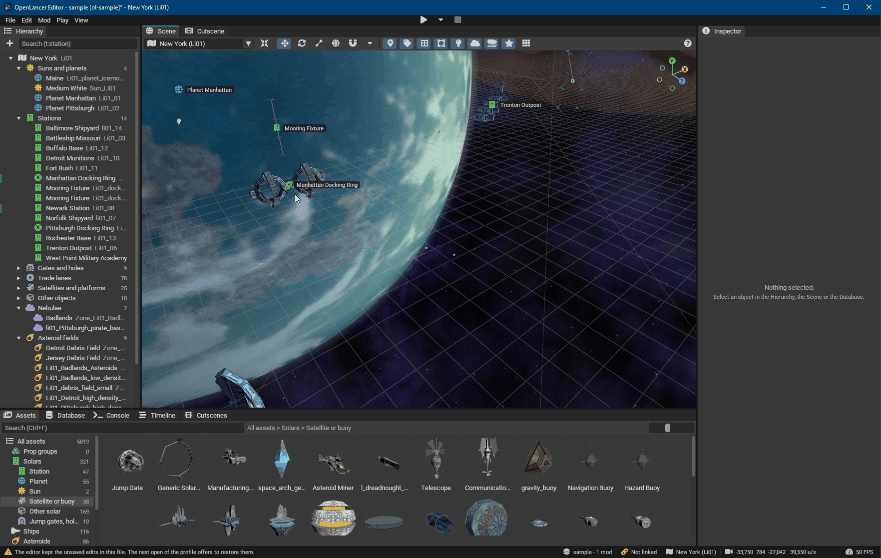
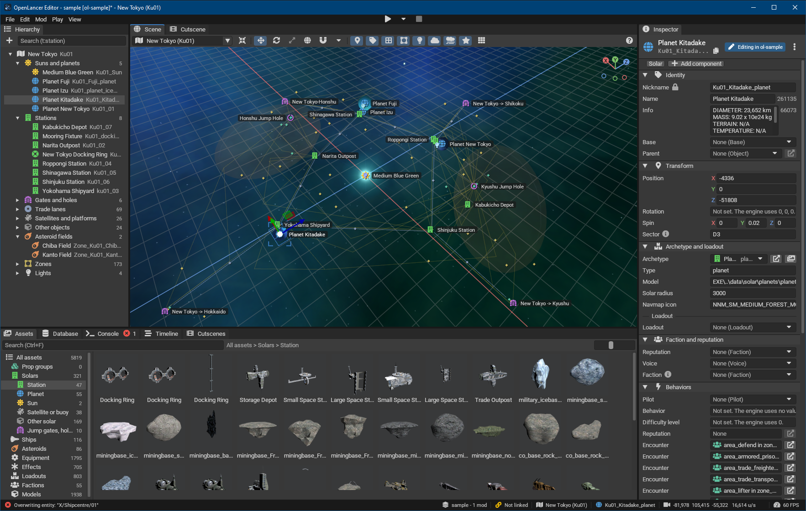
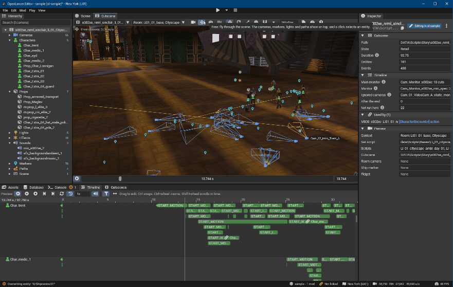
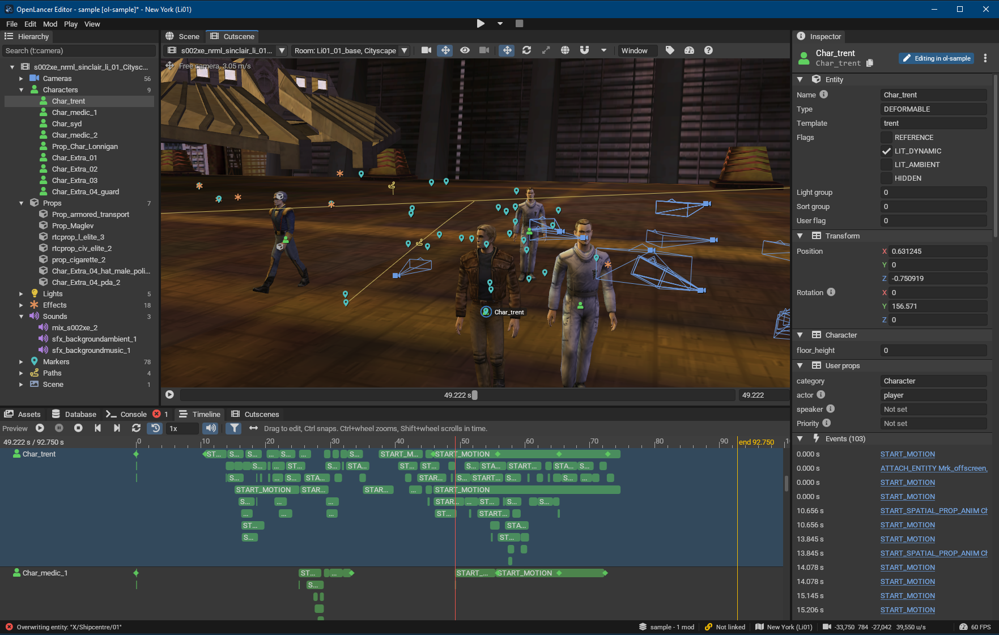

# OpenLancer

OpenLancer makes Freelancer (2003) openly moddable. It adds a mod overlay with a load order, and an editor for the game content. The editor has data editors, a 3D scene editor for star systems, and a cutscene editor. OpenLancer runs on its own fork of the [Librelancer](https://codeberg.org/Librelancer/Librelancer) engine. The fork is a git submodule at `external/Librelancer` (see docs/UPSTREAM.md).



> **No game files are in this repository.** It holds only OpenLancer's own code and documentation. There is no game data, no game executable and no game DLL. To use OpenLancer, you link your own copy of Freelancer (2003).

Contributions are welcome. Read [CONTRIBUTING.md](CONTRIBUTING.md) first. Fork the repository and open a pull request. The owner reviews each pull request before it goes into `master`. [ROADMAP.md](ROADMAP.md) shows the milestones.

## Legal

OpenLancer is an independent project. It is not affiliated with, endorsed by or sponsored by Microsoft, Digital Anvil, the Librelancer project or any holder of a "Freelancer" trademark. OpenLancer uses the name "Freelancer" only to identify the 2003 game that it works with. All trademarks belong to their owners.

This repository contains no game files and no game data. You need your own copy of Freelancer (2003). OpenLancer is licensed under the MIT License (see LICENSE). The third-party notices are in NOTICE.

## Folder layout

The repo is one folder in a larger workspace. The game data stays outside the repo.

```
<workspace>\
  Freelancer.iso      your retail disc image
  GameData\           private, never in git
    base\             extracted vanilla data (read-only)
    mods\  profiles\  out\  fonts\
  OpenLancer\         this repo
    assets\icon\            the icon of the programs: openlancer.svg and the files of tools/make_icon.py
    external\Librelancer\   submodule (see docs/UPSTREAM.md)
    release\                the texts and the license data of a binary release (tools/release.ps1)
    tests\
    tools\
```

## Set up

### Players

You need your own installed copy of Freelancer (2003): the retail game 1.0 or 1.1, with or without JFLP, or Freelancer: HD Edition.

1. Unzip the OpenLancer release to a folder of your choice.
2. Start `OpenLancer.Editor.exe`.
3. On the page "Link your Freelancer game", click **Select game folder...**. Select the folder that contains the `EXE` and `DATA` folders of your game, for example `C:\Program Files (x86)\Microsoft Games\Freelancer`. You can also drag the folder to the editor window.
4. The editor shows the game and the version that it found. Click **Create profile and open**.

The editor makes a profile for your game and an empty mod, `my-mod`, and opens the profile. Your edits go into `my-mod`. OpenLancer reads the files of the game folder. It never changes them. Your profiles and mods go to `Documents\OpenLancer`. **File > Game link...** shows the linked games and their profiles. When you move the game, **Relink...** in that window gives the profiles the new folder. See [docs/GAME_LINK.md](docs/GAME_LINK.md).

### Developers

1. Clone with submodules: `git clone --recursive <url> OpenLancer`.
2. Extract the game data to `GameData\base` and check it with `python tools\verify_base.py ..\GameData\base`. The English v1.0 retail disc gives `8418 5b4ee64cf64bb9c5525cee786f54380170dbde5617d1aaf5ef3655237c9cfaeb`.
3. Build the engine submodule once. See "Build the submodule" in [docs/UPSTREAM.md](docs/UPSTREAM.md).
4. Run `dotnet test OpenLancer.slnx`.
5. Run `start.bat` to build and start the editor. The editor lists the profiles of `GameData\profiles` and of the workspace folder. To link the game as a player does, click **File > Game link... > Link a game folder...** and select `GameData`. The editor finds `GameData\base`.

The data tests read `..\GameData\base`. Set `OPENLANCER_BASE` to use a different folder. Without game data, the data tests are skipped. `oltool game <folder>` prints the check of a game folder (see [docs/GAME_LINK.md](docs/GAME_LINK.md)).

## Make a mod



*Select an object in the Hierarchy or the Scene, change it in the Inspector, or drag an asset from the Assets panel into the Scene.*

See [docs/MOD_FORMAT.md](docs/MOD_FORMAT.md). `samples/mods/ol-sample` is a complete example: it changes a price, and it adds a new ship that Manhattan sells.

1. Make a profile, for example `GameData\profiles\my.json` with `{ "mods": [ "../mods/my-mod" ] }`.
2. Run `oltool validate GameData\profiles\my.json`.
3. Run `oltool deploy GameData\profiles\my.json`.
4. Start the game with `lancer.exe GameData\profiles\my.lancer.ini`.

To make the packages that players install, pick **Mod > Export mod...** in the editor, or run `oltool export`. The export makes a drop-in zip and an FLMM package for HD Edition 0.7.1 and for Freelancer 1.1 from the files of your linked games. It also makes a zip of the mod folder for OpenLancer. See "Export" in [docs/MOD_FORMAT.md](docs/MOD_FORMAT.md).

**Mod > Mods...** shows each mod of the profile and the workspace with its export state. Give a mod the display name that players see, and write the texts of its Nexus page before the export. A publish checklist tells what a release still needs, and the History tab shows each export and test play. See "The Mods window" in [docs/MOD_FORMAT.md](docs/MOD_FORMAT.md).

Some data loads in OpenLancer but crashes the retail game, for example a good with the price 0. For a mod with a retail target, the editor stops a save, a Play in the game and an export with such data. The Console tells why. Run `oltool validate GameData\profiles\my.json --target hde-0.7.1 --game "<HD Edition folder>"` to check a profile for a retail game. See "Content checks of the retail game" in [docs/MOD_FORMAT.md](docs/MOD_FORMAT.md).

## Play from the editor

Run `start.bat` to build and start the editor. Open a profile and a system, then press F5. The game starts at the Scene camera with the edits of the active mod, and a save reloads the running game. See [docs/PLAY.md](docs/PLAY.md).

To play the mods in your own retail game, pick **Play > Play in HD Edition 0.7.1** (or another linked game), or press Ctrl+F5. The editor installs the mods into a play copy next to the game and starts the game of the play copy. Your game folder does not change. **Play > Host test server** starts FLServer of the play copy with the mods. See "Play in the game" in [docs/PLAY.md](docs/PLAY.md) and "Play copies" in [docs/GAME_LINK.md](docs/GAME_LINK.md).

## Read missions

Open the Missions tab of the editor to see the mission scripts of the game data and the mods. The 14 story missions come first, in the order of the game. Each row gives the start stage, the next mission, the problems and the lines that OpenLancer does not run. Double-click a mission to open it in the Mission tab.

The Mission tab shows the mission as a graph beside the Scene. Each box is one trigger: the event that starts it, and what it does. Frames group the acts and the behavior prefabs, for example a spawn wave. A lens shows one part of the mission, for example the battles or the conversations. Select a trigger, and the Scene shows the ships, points and volumes that it uses. Select an item in the Scene, and the graph shows the triggers that use it.

The Hierarchy lists the items of the open mission, and the Inspector shows each item with named fields and a completeness panel. The Raw INI view shows the whole script with the marks of the checks. This version shows mission scripts but does not change them. The toggle "base-game messages" shows the problems that the base game has too. They are hidden by default.

To measure the frame time of the Mission tab, start the editor with `OpenLancer.Editor <profile.json> --bench-mission <install path>...`. For example, give the scripts `DATA\MISSIONS\M10\m10.ini` and `DATA\MISSIONS\M06\m06.ini`. The bench opens the profile without an active mod and shows each mission with the Scene beside it. For each mission, it draws 300 frames in the Beats lens and 300 frames in the Logic lens with "Show lines". The frames pan and zoom the graph.

Then the bench writes the median and the 95th percentile of the frame times to the engine log of the editor, and closes. The gates are a median under 16 ms in the Beats lens and under 33 ms in the Logic lens. A case above its gate, or a script that the mission checks do not have, gives the exit code 1. The bench does not change the editor settings. The log is the file of the cutscene bench `--bench-cutscene` (see "The Cutscene tab" in [docs/CUTSCENES.md](docs/CUTSCENES.md)).

## Study and edit cutscenes

Open the Cutscenes tab of the editor to browse the retail cutscenes and the cutscenes of the mods. Open one to preview it on a timeline and to see each value. With Mod > None (read-only), the editor takes no edits. With an active mod, a save writes the changes of a cutscene as a small THN patch. See [docs/CUTSCENES.md](docs/CUTSCENES.md).






## Agents

An agent program, for example Claude Code, can read the data of a profile through the agent server of OpenLancer (an MCP server). This version has the read tools: the systems and their items, the data lists, the assets, the missions, the cutscenes, the raw INI text and the checks. It also has the view tools of the editor. No tool changes a file.

To connect an agent to the editor:

1. Open a profile in the editor.
2. Pick **Agent > Start agent server**. At the first start, a notice tells what the agent reads. The agent program can send that data to its model service.
3. Pick **Agent > Connect an agent...** and click **Copy**.
4. Paste the text into the file `.mcp.json` in the folder of your agent project.
5. Start the agent program in that folder.

The text names the server address `http://127.0.0.1:<port>/mcp` and the token helper `"<OpenLancer folder>\oltool.exe" mcp token`. The editor makes a new token at each start of the server, and the helper gives it only to the running server. The status bar shows the state of the server. **Agent > Show agent messages** shows the messages of the server in the Console. **Agent > Agent settings** has the port (47815 by default), the tool groups and the limits.

The view tools work only in the editor:

- `open_view` opens a system in the Scene, a mission in the Mission tab or a cutscene in the Cutscene tab.
- `select_items` selects an item, as a click does. By default, it also opens the view of the item and moves the view to it.
- `render_scene` gives an image of a system from a camera that the agent chooses. The camera of the Scene does not move, and the Scene keeps its system. The result also gives the place of each item in the image.
- `render_cutscene` gives an image of a cutscene at a time. The preview in the Cutscene tab does not change. A space script shows without its system.
- `capture_panel` gives an image of a panel as you see it, with its marks and labels.

The agent program can send each image to its model service, and a capture of a panel can show the names of your folders. An image has at most 2048 pixels on each side, and a larger panel gives a smaller image. **Agent > Agent settings > Advanced** can set a smaller limit. The editor does not draw a frame while it renders an image. An image of a system that the Scene does not show also loads that system first.

To measure the images, start the editor with `OpenLancer.Editor <profile.json> --bench-agent-render <system>`, with the nickname of a system of the profile. The bench opens the profile without an active mod and opens the system. It renders one image of 1024 by 640 to warm up, then one image from each of 10 directions, as `render_scene` does. For each image, it writes the time on the UI thread and the time until the PNG is ready to the engine log of the editor. The time on the UI thread includes the work of the GPU. Then the bench closes. The gate is a median under 100 ms. A median above the gate, or an image that fails, gives the exit code 1. The bench needs no agent server and does not change the editor settings.

The server accepts connections from this computer only. It listens on 127.0.0.1, and each request needs the token. Use the address with `127.0.0.1`, not `localhost`. The helper gives no token for `localhost`, because another program can listen on the IPv6 address of `localhost`. Never put a proxy or a tunnel, for example a Tailscale Funnel, in front of the port of the agent server.

To run the tools without the editor, add a server that starts oltool:

```json
{
  "mcpServers": {
    "openlancer-headless": {
      "type": "stdio",
      "command": "<OpenLancer folder>\\oltool.exe",
      "args": ["mcp", "serve", "<workspace>\\profiles\\my-profile.json", "--mod", "my-mod", "--read-only"]
    }
  }
}
```

`oltool mcp tools` lists the tools. The editor writes each call of an agent into an audit log in the log folder of OpenLancer, and `oltool mcp replay <profile.json> --mod <id> <log>` runs the calls of a log again and compares the results. The name of each read tool starts with `list_`, `get_`, `find_`, `search_`, `describe_` or `check`, or is `studio_status`. So a permission rule of the agent program, for example `mcp__openlancer__list_*`, can allow them. `render_scene`, `render_cutscene` and `capture_panel` also change nothing. The rules `mcp__openlancer__render_*` and `mcp__openlancer__capture_panel` allow them. `open_view` and `select_items` change what the editor shows.
